# Web Tools

## Installing / Running

The web tools can be run from a terminal (akin to a Jupyter Notebook) or installed on a server for a whole site. See [GitHub](http://github.com/heidthecamp/mdsplus-web-tools) for instructions.  

## Coming from another tool?

### For users of dwscope, jScope, traverser, jTraverser, jTraverser2

One of the main goals while developing the web tools was to have them be backwards compatible with previous MDSplus tools and feel comfortable to existing users. Any features from the existing tools that are not currently included are planned, see [Planned Features](#planned-feature-upgrades).  

Users with existing `.dat` or `.jscp` files can import them directly, either through dragging and dropping or through the Import button in the main menu. Any issues with the import should be reported as [GitHub issues](https://github.com/heidthecamp/mdsplus-web-tools/issues).  

### For users of tools like Grafana

As the MDSplus web tools were designed to directly replace the existing MDSplus tools, there will be some differences for users comfortable with tools like Grafana. First, MDSplus is not naturally time-series, so there is no need to define a time range for a dashboard. Instead, use the [Shot Scrubber](#shot-scrubber) to move through shots, which should represent time ranges of the experiment. Second, not all settings will be in each panel, additional settings live in [Global Settings](#global-settings) which can be used to easily configure many plots to view related data.  

Plots can be added and resized much like in a Grafana. Additional features and inspiration from tools such as this are being evaluated and incorporated.  

For many projects you may want to use common fields (such as tree, shot or min/max values). For this we added a global settings where you can set common values for fields to be used in the [Panels](#panels) and [Traces](#traces). Default values can be overwritten (or set to empty) in the panel/trace-forms by unselecting the checkbox next to the field.   

## Global Settings

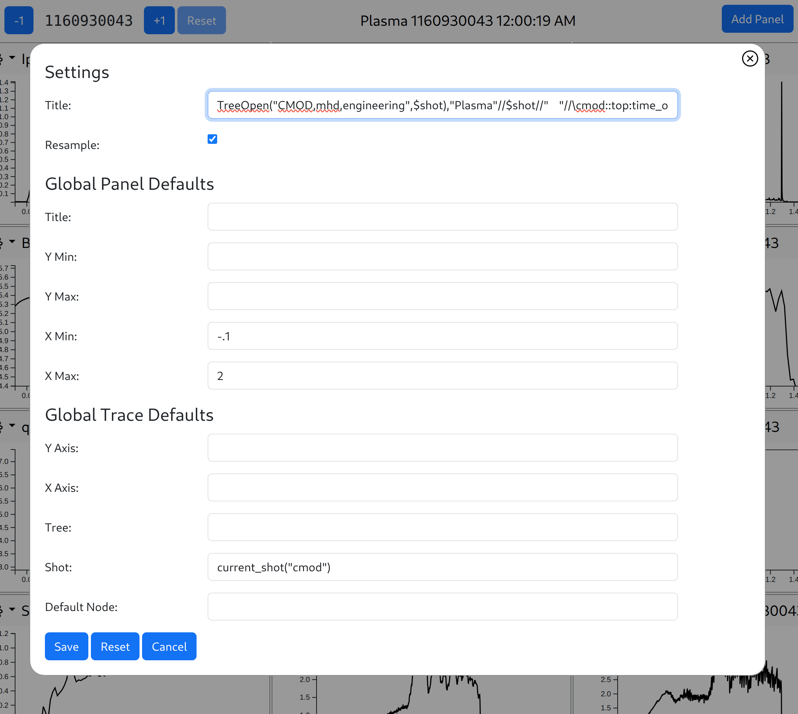

### Settings

 **Title:** This will be evaluated and then set the page title. *This will be evaluated before and after all the panels (before: so any variables put into this field will propagate through the rest of the TDI expressions; after: so the results of the page can be displayed in the title).*  
**Resample:** This controls the behavior of how expressions are evaluated and then returned. This adds a wrapper to expressions that will shrink the data being returned to just twice the number of pixels along the x axis taking the high and low values allowing maintained fidelity with a faster network call. *It is recommended to have this on, however if you notice anomalous behavior in your graphs it can be turned off. This can only be controlled for the page and not individual panels.*  

### Global Panel Defaults

These values are used for all panel settings with the Global Defaults checkbox checked. See [Panels](#panels) for comprehensive list of the values. This is useful to set standard X/Y axis limits so that all plots are aligned.  
Note: Variables in these values are evaluated during the evaluation of the panel, used alongside the other panel settings.  

### Global Trace Defaults

These values used for all trace settings with the Global Defaults checkbox checked. See [Traces](#traces) for comprehensive list of the values. This is useful for setting a global tree/shot for all plots, such that you only need to configure the nodes they will display.  
Note: TDI Variables in these values are evaluated during the evaluation of the trace, used alongside the other panel settings.  

## Panels

A Panel can display one or more traces from different trees, shots, nodes, etc on the same plot. Panels can be resized by dragging the bottom right corner and moved to the desired width and height.  
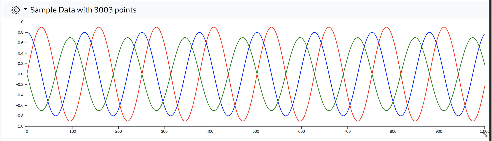  
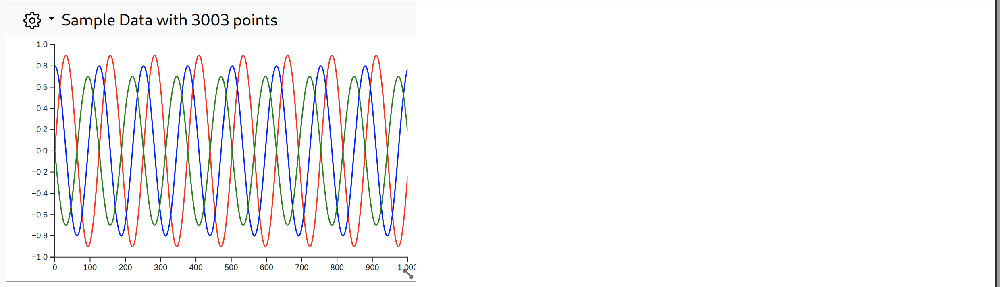  
Panels can also be moved by dragging the white space in the panel header.  

To modify the panel, open the  icon and select edit.  
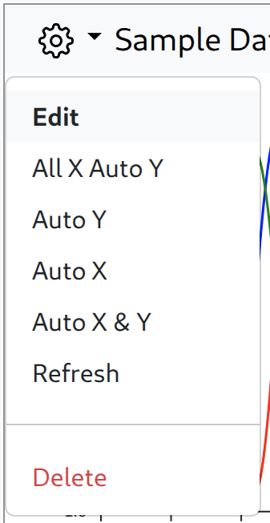  
This will open the panel edit form.  
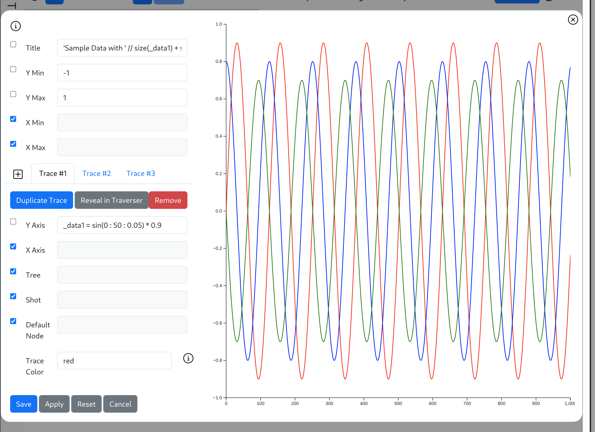  
From here you can modify features of the panel, such as the panel title and min/max height and width, as well as the individual [Traces](#traces).  

Next to all the fields listed below you will see a checkbox. When checked, this will default the value to the [Global Defaults](#global-panel-defaults).  

**Title:** This is the title for the panel.  
**Y Min:** The lower limit of the Y axis, is a TDI expression. If left blank, the lowest value of the Y data will be used.  
**Y Max:** The upper limit of the Y axis, is a TDI expression. If left blank, the highest value of the Y data will be used.  
**X Min:** The lower limit of the X axis, is a TDI expression. If left blank, the lowest value of the X data will be used.  
**X Max:** The upper limit of the X axis, is a TDI expression. If left blank, the highest value of the X data will be used.  

## Traces

A trace is an individual set of data displayed on a plot.  

Since a plot can have multiple traces you must select or add a tab at the top of the trace section. You can add a new trace from scratch by clicking on the  button to the left of the trace tabs.  

At the top of the Trace Tab you will find buttons to:  
**Duplicate Trace**: Take all of the current trace’s options and create a new trace identical that can be modified independently.  
**Reveal in Traverser**: Attempts to find the node specified in the Y Axis field for the Tree/Shot and open it in a [Traverser Sidebar](#traverser-sidebar).  
**Remove**: Deletes the trace selected from the panel.  

Next to all the fields listed below you will see a checkbox. When checked, this will default the value to the [Global Defaults](#global-trace-defaults).  

**Y Axis:** The TDI expression to evaluate to retrieve the Y data to be displayed, can simply be the path to a node.  
**X Axis:** The TDI expression to evaluate to retrieve the X data to be displayed, can be left blank and will default to `dim_of([Y Data])`.  
**Tree:** The name of the MDSplus tree to open, along with the shot below, to retrieve data from.  
**Shot:** The TDI expression to evaluate to use as the shot number when opening the MDSplus tree to retrieve data from. Will often be a simple integer, but expressions may be used for more advanced configurations.  
**Default Node:** The node that will be used as the default node, all other nodes will be referenced relative to this one. If none is specified it will default to `\\TOP`.  
**Trace Color:** The color of the trace, this can use any of the colors available in HTML if a word is input, or you can hex value RGB colors (e.g. `#FF0000` or `rgba(255,0,0,255)` for red). Note: These colors will be inverted in dark mode.  

## Shot Scrubber

For quickly moving between nearby shots, the shot scrubber allows you to add or subtract one from the current shot number as defined in the [Global Trace Defaults](#global-trace-defaults). This can be very useful for looking at subsequent shots in a given day or run. This offset will not be saved, and will be reset to 0 when reloading.  

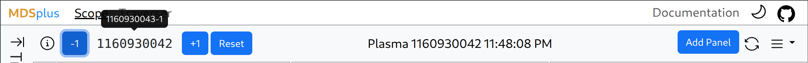  

## Saving/Loading

The page is automatically saved periodically using the browser's local storage. To save a file off line go to the top right and select the  menu and select export. This will save a file called `scope.json` to your downloads.  
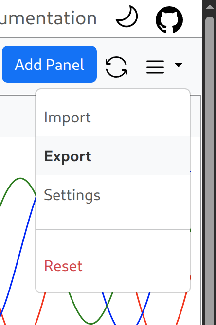  

The scope can load exported files, as well as dwscope and jScope files (`.dat` and `.jscp`). When importing older files the scope does its best approximation of how the old files were configured.  

## Sidebar Traverser

To the left, you will find a Traverser that can explore trees and even create panels from nodes.  
To open a tree click the dropdown and select `Open`, then enter the desired tree and shot.  
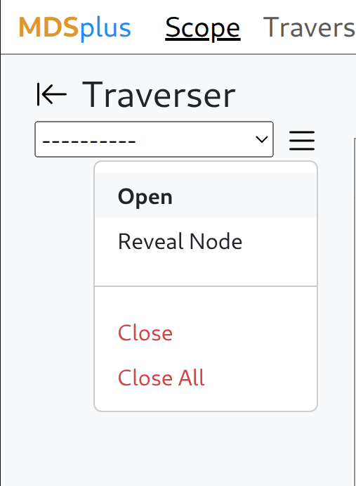  
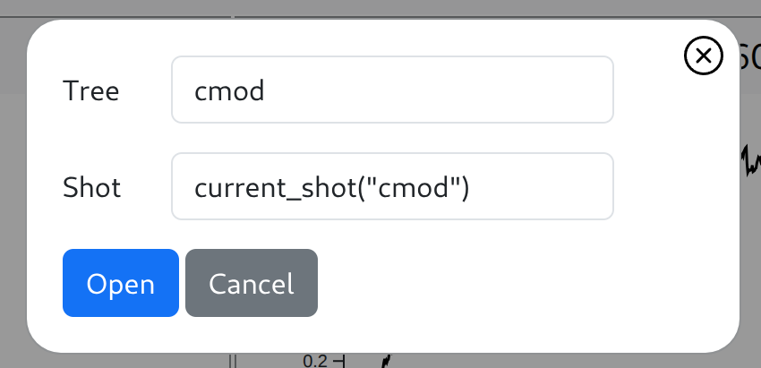  
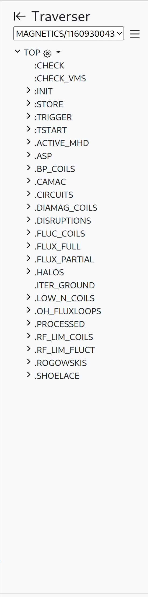  

You can search the tree manually, or if you know the node you are looking for you can use the **Reveal Node** function.  
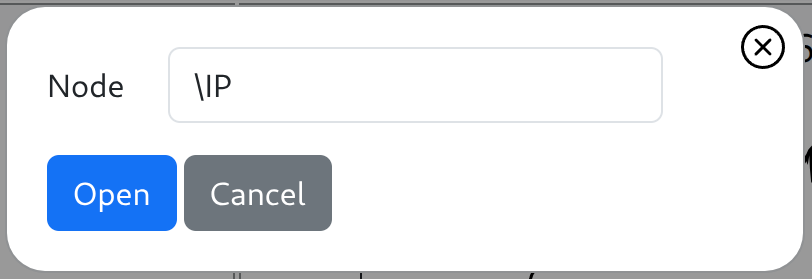  
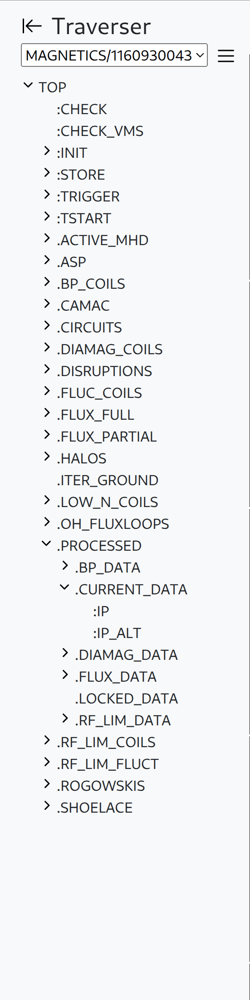  

You can preview a node's data by hovering.  
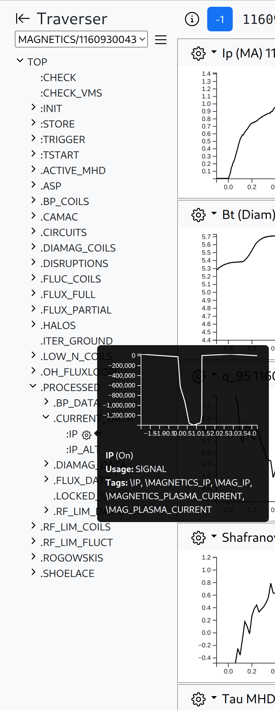  

Or you can do a deeper dive into its data/metadata by clicking the  and selecting display.  
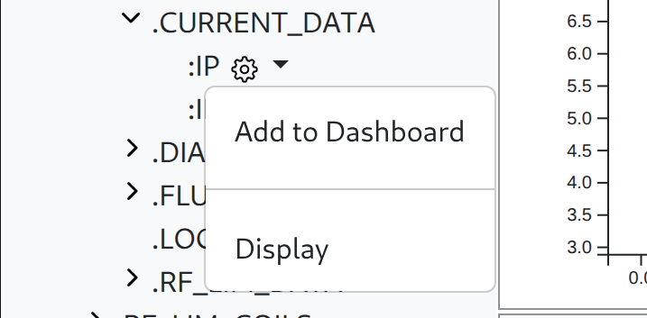  
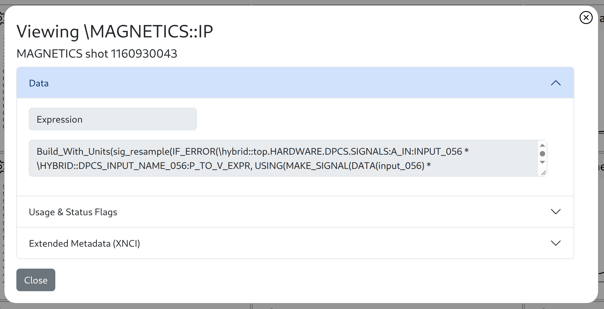  

By selecting **Add to Dashboard** a new panel will be generated with the current tree, shot, and node as the Y Axis.  

## Bugs and planned upgrades

While striving to provide the best experience we need to balance that with the realities of time constraints and actually releasing the tools. We are doing our best to acknowledge the limitations the web tools currently have as well as share thoughts on how to make them better. If you have a bug to report or a feature to request you can do so on the [GitHub](www.github.com/heidthecamp/mdsplus-webtools/issues).  

### Planned feature upgrades:

Traverser Page  
Third party database support  
Better mobile support  

### Known bugs

Certain page widths can cause elements to overlap (ie the scope and the side bar traverser) (work around: expand browser width)  
Occasionally when resizing a panel the plot does not correctly resize (workaround: reloading the page)  
